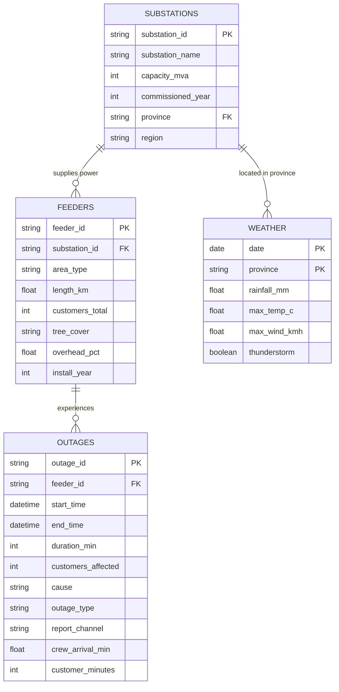

# พจนานุกรมข้อมูลฉบับสมบูรณ์ (Data Dictionary)
**โครงการ**: การวิเคราะห์ข้อมูลระบบไฟฟ้าดับ บริษัท ล้านนาพาวเวอร์ดิสทริบิวชัน จำกัด  
**เวอร์ชันข้อมูล**: 1.0.0 (Cleaned Data for Competition 2568)  
**รูปแบบการจัดเก็บ**: CSV (UTF-8 with BOM) และ Parquet (Snappy Compressed)  

---

## 1. แผนภาพความสัมพันธ์ของข้อมูล (Entity-Relationship Diagram)

---

## 2. ตารางเหตุการณ์ไฟฟ้าดับ (`outages_clean.csv` / `outages_clean.parquet`)
* **ความหมาย**: บันทึกประวัติการเกิดไฟฟ้าดับ 1 แถว = 1 เหตุการณ์  
* **จำนวนเรคอร์ด**: 2,743 แถว (Unplanned: 2,594 แถว, Planned: 149 แถว)  
* **ช่วงเวลาข้อมูล**: 1 มกราคม 2566 00:00:00 ถึง 31 ธันวาคม 2567 23:59:59  

| ชื่อคอลัมน์ | ชื่อเดิม | ชนิดข้อมูล | โดเมน / หน่วย | ค่าว่างที่อนุญาต | คำอธิบายความหมายและนโยบายการจัดการข้อมูล | ตัวอย่างข้อมูล |
| :--- | :--- | :---: | :---: | :---: | :--- | :--- |
| **`outage_id`** | `outage_id` | `VARCHAR(32)` | รหัสเฉพาะ (PK) | ไม่อนุญาต | รหัสเฉพาะของเหตุการณ์ไฟดับ ขึ้นต้นด้วย `OUT-YYYY-######` หรือ `OUT-CC-#####` | `OUT-2023-000001` |
| **`feeder_id`** | `feeder_id` | `VARCHAR(16)` | รหัสสายป้อน (FK) | ไม่อนุญาต | รหัสสายป้อนที่เกิดเหตุ ปรับฟอร์แมตมาตรฐาน `[A-Z]{3}-F\d{2}` อัตรา FK Match 99.64% | `CMI-F20` |
| **`start_time`** | `start_time` | `DATETIME` | วันที่-เวลา (ISO) | ไม่อนุญาต | วันและเวลาที่เริ่มเกิดไฟฟ้าดับ แปลงปี พ.ศ. เป็น ค.ศ. และแก้ไขปี Typo | `2023-01-01 16:46:16` |
| **`end_time`** | `end_time` | `DATETIME` | วันที่-เวลา (ISO) | ไม่อนุญาต | วันและเวลาที่ระบบจ่ายไฟกลับคืนสู่สภาวะปกติ (สลับค่าหากพบ end < start) | `2023-01-01 18:51:16` |
| **`duration_min`** | `duration_min` | `INTEGER` | นาที (Minutes) | ไม่อนุญาต | ระยะเวลาที่ไฟดับจริง คำนวณจาก `(end_time - start_time)` ตัดค่า Placeholder 9999 | `125` |
| **`customers_affected`**| `customers_affected`| `INTEGER` | ราย (Customers) | ไม่อนุญาต | จำนวนผู้ใช้ไฟที่ได้รับผลกระทบ ตัดจุลภาคออก และ Cap ไม่เกิน `customers_total` | `1707` |
| **`cause`** | `cause` | `VARCHAR(32)` | 8 กลุ่มมาตรฐาน | ไม่อนุญาต | สาเหตุการดับ จัดกลุ่มจาก 26 คำเรียกเข้าสู่: `tree`, `lightning`, `animal`, `equipment`, `vehicle`, `overload`, `planned`, `unknown` | `tree` |
| **`outage_type`** | `outage_type` | `VARCHAR(16)` | `unplanned`/`planned`| ไม่อนุญาต | ประเภทการดับไฟ จัดกลุ่มเป็น `unplanned` (ไม่ได้วางแผน) หรือ `planned` (ตามแผน) | `unplanned` |
| **`report_channel`** | `report_channel`| `VARCHAR(32)` | ช่องทางรับแจ้ง | อนุญาต | ช่องทางที่ตรวจพบเหตุการณ์: `SCADA`, `Call Center 1129`, `Mobile App` | `Call Center 1129` |
| **`crew_arrival_min`** | `crew_arrival_min`| `FLOAT` | นาที (Minutes) | ไม่อนุญาต | ระยะเวลาที่ทีมช่างใช้ในการเดินทางถึงหน้างาน (Impute ค่าว่างด้วยมัธยฐานพื้นที่) | `77.0` |
| **`customer_minutes`** | *(สร้างใหม่)* | `INTEGER` | นาที-ราย | ไม่อนุญาต | ผลคูณระหว่าง `customers_affected * duration_min` ใช้เป็นตัวตั้งคำนวณ SAIDI | `213375` |

---

## 3. ทะเบียนสายป้อน (`feeders_clean.csv` / `feeders_clean.parquet`)
* **ความหมาย**: ข้อมูลคุณลักษณะทางวิศวกรรมของสายป้อนจากระบบ GIS  
* **จำนวนเรคอร์ด**: 54 แถว (ลบแถวซ้ำ CMI-F18 ออก 1 แถว)  
* **จำนวนผู้ใช้ไฟฟ้ารวมทั้งระบบ**: 212,196 ราย  

| ชื่อคอลัมน์ | ชื่อเดิม | ชนิดข้อมูล | โดเมน / หน่วย | ค่าว่างที่อนุญาต | คำอธิบายความหมายและนโยบายการจัดการข้อมูล | ตัวอย่างข้อมูล |
| :--- | :--- | :---: | :---: | :---: | :--- | :--- |
| **`feeder_id`** | `Feeder ID` | `VARCHAR(16)` | รหัสเฉพาะ (PK) | ไม่อนุญาต | รหัสประจำสายป้อน รูปแบบ `[A-Z]{3}-F\d{2}` | `CMI-F01` |
| **`substation_id`** | `Substation` | `VARCHAR(16)` | รหัสสถานี (FK) | ไม่อนุญาต | รหัสสถานีไฟฟ้าย่อยต้นทาง เชื่อมโยงกับ `substations_clean` | `SS-CMI-01` |
| **`area_type`** | `Area Type` | `VARCHAR(16)` | `urban`/`suburban`/`rural` | ไม่อนุญาต | ลักษณะพื้นที่: `urban` (เขตเมือง), `suburban` (ชานเมือง), `rural` (ชนบท) | `urban` |
| **`length_km`** | `Length` | `FLOAT` | กิโลเมตร (km) | ไม่อนุญาต | ความยาวรวมของสายป้อน (แปลงสายที่บันทึกเป็นเมตรโดยหาร 1,000) | `8.45` |
| **`customers_total`** | `Customers` | `INTEGER` | ราย (Customers) | ไม่อนุญาต | จำนวนผู้ใช้ไฟฟ้าทั้งหมดในสายป้อน (ใช้เป็นตัวหารคำนวณ SAIFI/SAIDI) | `6250` |
| **`tree_cover`** | `Tree Cover` | `VARCHAR(16)` | `low`/`medium`/`high` | ไม่อนุญาต | ความหนาแน่นของต้นไม้ตามแนวสาย: `low`, `medium`, `high` | `low` |
| **`overhead_pct`** | `Overhead %` | `FLOAT` | ร้อยละ (%) | ไม่อนุญาต | สัดส่วนสายไฟแบบแขวนอากาศ (Overhead Line) เทียบกับสายใต้ดิน | `72.5` |
| **`install_year`** | `Install Year` | `INTEGER` | ปี ค.ศ. | ไม่อนุญาต | ปีที่ก่อสร้างและจ่ายไฟครั้งแรก (วิเคราะห์อายุการใช้งานอุปกรณ์) | `1997` |

---

## 4. ทะเบียนสถานีไฟฟ้าย่อย (`substations_clean.csv` / `substations_clean.parquet`)
* **ความหมาย**: ข้อมูลสถานีไฟฟ้าย่อยต้นทางที่แปลงโครงสร้างซ้อน (Nested JSON) เป็น Flat Tabular Data  
* **จำนวนเรคอร์ด**: 8 สถานีครอบคลุม 4 จังหวัด  

| ชื่อคอลัมน์ | ชื่อเดิม | ชนิดข้อมูล | โดเมน / หน่วย | ค่าว่างที่อนุญาต | คำอธิบายความหมายและนโยบายการจัดการข้อมูล | ตัวอย่างข้อมูล |
| :--- | :--- | :---: | :---: | :---: | :--- | :--- |
| **`substation_id`** | `substation_id` | `VARCHAR(16)` | รหัสเฉพาะ (PK) | ไม่อนุญาต | รหัสประจำสถานีไฟฟ้าย่อย เช่น `SS-CMI-01` | `SS-CMI-01` |
| **`substation_name`** | `substation_name` | `VARCHAR(64)` | ชื่อสถานี | ไม่อนุญาต | ชื่อทางการของสถานีไฟฟ้า | `สถานีไฟฟ้าเชียงใหม่ 1 (เมือง)` |
| **`capacity_mva`** | `capacity_mva` | `INTEGER` | MVA | ไม่อนุญาต | กำลังการจ่ายไฟฟ้าติดตั้ง ตัดสตริงหน่วย 'MVA' ออกเป็นตัวเลขจำนวนเต็ม | `115` |
| **`commissioned_year`**| `commissioned_year`| `INTEGER` | ปี ค.ศ. | ไม่อนุญาต | ปีที่เปิดดำเนินการจ่ายไฟเชิงพาณิชย์ | `1995` |
| **`province`** | `location.province`| `VARCHAR(32)` | ชื่อจังหวัด | ไม่อนุญาต | จังหวัดที่ตั้ง: `เชียงใหม่`, `ลำพูน`, `ลำปาง`, `เชียงราย` | `เชียงใหม่` |
| **`region`** | `location.region` | `VARCHAR(32)` | ภูมิภาค | ไม่อนุญาต | ภูมิภาค: `ภาคเหนือ` | `ภาคเหนือ` |

---

## 5. สภาพอากาศรายวันต่อจังหวัด (`weather_clean.csv` / `weather_clean.parquet`)
* **ความหมาย**: ข้อมูลสภาพภูมิอากาศระดับจังหวัดรายวันจากสถานีตรวจวัดกรมอุตุนิยมวิทยา  
* **จำนวนเรคอร์ด**: 2,899 วัน-จังหวัด  

| ชื่อคอลัมน์ | ชื่อเดิม | ชนิดข้อมูล | โดเมน / หน่วย | ค่าว่างที่อนุญาต | คำอธิบายความหมายและนโยบายการจัดการข้อมูล | ตัวอย่างข้อมูล |
| :--- | :--- | :---: | :---: | :---: | :--- | :--- |
| **`date`** | `date` | `DATE` | วันที่ (YYYY-MM-DD) | ไม่อนุญาต | วันที่ตรวจวัดสภาพอากาศ | `2023-01-01` |
| **`province`** | `province` | `VARCHAR(32)` | ชื่อจังหวัด (FK) | ไม่อนุญาต | จังหวัดที่ตั้งของสถานีตรวจวัด | `เชียงใหม่` |
| **`rainfall_mm`** | `rainfall_mm` | `FLOAT` | มิลลิเมตร (mm) | ไม่อนุญาต | ปริมาณฝนสะสม 24 ชม. (แปลงค่า Sentinel -999 เป็น 0.0 มม.) | `12.5` |
| **`max_temp_c`** | `max_temp_c` | `FLOAT` | องศาเซลเซียส (°C) | ไม่อนุญาต | อุณหภูมิสูงสุดประจำวัน (แปลงค่า °F ของลำพูนกลับเป็น °C) | `32.4` |
| **`max_wind_kmh`** | `max_wind_kmh` | `FLOAT` | กม./ชม. (km/h) | ไม่อนุญาต | ความเร็วลมกระโชกสูงสุดในรอบวัน | `45.2` |
| **`thunderstorm`** | `thunderstorm` | `BOOLEAN` | `True` / `False` | ไม่อนุญาต | สถานะการตรวจพบพายุฝนฟ้าคะนองในพื้นที่ | `True` |
